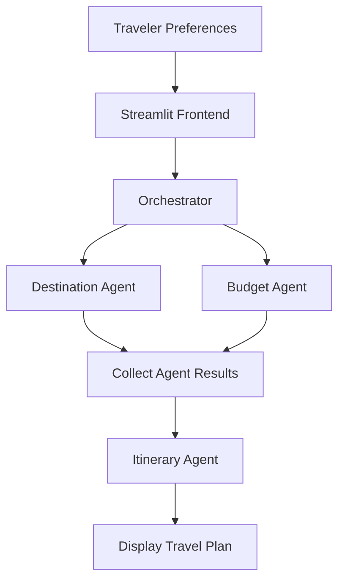

# ✈️ TripWeaver AI --- Personalized Multi-Agent Travel Planner

**Plan smarter trips with AI-powered destination recommendations, budget
assessment, and personalized itineraries.**

TripWeaver AI is a travel-planning application built with Python,
Streamlit, and Google's Gemini API. It uses three specialized AI agents
coordinated by an orchestrator to turn a traveler's preferences into a
structured travel plan.

The application considers the destination, trip duration, number of
travelers, total budget, interests, travel pace, travel style, and
optional preferences.

## 📸 Application Preview


> Add your screenshot to the repository at
> `assets/tripweaver-preview.png`. If you use a different filename or
> folder, update the image path above.

## ✨ Features

-   **🗺️ Destination Recommendations:** Suggests attractions and
    activities based on the traveler's interests and preferences.
-   **💰 Budget Assessment:** Estimates accommodation, local
    transportation, food, and sightseeing expenses, then compares the
    estimated total with the available budget.
-   **🗓️ Personalized Itinerary:** Generates a day-by-day schedule
    organized into morning, afternoon, and evening activities.
-   **🤖 Multi-Agent Architecture:** Separates destination
    recommendations, budget assessment, and itinerary generation into
    specialized agents.
-   **⚡ Concurrent Execution:** Runs the Destination and Budget agents
    concurrently before passing their results to the Itinerary Agent.
-   **🎨 Interactive Interface:** Collects travel preferences and
    displays the generated plan through Streamlit.
-   **🔐 Environment-Based Configuration:** Loads the Gemini API key
    from environment-based configuration rather than hardcoding
    credentials.

## 🛠️ Tech Stack

  -----------------------------------------------------------------------
  Technology                          Purpose
  ----------------------------------- -----------------------------------
  Python                              Application logic and agent
                                      implementation

  Streamlit                           Interactive web interface

  Google Gemini API                   AI-powered travel planning

  Google Gen AI SDK (`google-genai`)  Communication with Gemini models

  `ThreadPoolExecutor`                Concurrent execution of the first
                                      two agents

  `python-dotenv`                     Loading local environment variables

  Git and GitHub                      Version control and project hosting
  -----------------------------------------------------------------------

## 🏗️ Architecture

The orchestrator runs the Destination and Budget agents concurrently.
Once both results are available, it passes them to the Itinerary Agent
to generate the final plan.



### Destination Agent --- `agents/destination.py`

Recommends attractions and activities based on the destination,
interests, travel pace, and additional preferences. Recommendations
include why each activity matches, suggested time, and practical tips.

### Budget Agent --- `agents/budget.py`

Estimates accommodation, local transport, food and sightseeing expenses.
It calculates an estimated total, compares it with the available budget,
and suggests possible savings.

### Itinerary Agent --- `agents/itinerary.py`

Creates a day-by-day itinerary using the Destination Agent's
recommendations and the Budget Agent's assessment. It considers the
traveler's pace, interests, travel style, and additional preferences.

### Orchestrator --- `agents/orchestration.py`

Coordinates the workflow:

1.  Starts the Destination and Budget agents concurrently using
    `ThreadPoolExecutor`.
2.  Collects both agent results.
3.  Passes both outputs to the Itinerary Agent.
4.  Returns all three results to the frontend.

This separation of responsibilities keeps the application modular and
easier to maintain.

## 📁 Project Structure

``` text
TripWeaver_AI/
├── agents/
│   ├── __init__.py
│   ├── destination.py
│   ├── budget.py
│   ├── itinerary.py
│   └── orchestration.py
├── assets/
│   └── tripweaver-preview.png
├── app.py
├── requirements.txt
├── .gitignore
└── README.md
```

The `assets/` folder is for the README screenshot. Create it and add the
image if you want the preview to appear on GitHub.

## 🚀 Getting Started

### Prerequisites

-   Python installed and compatible with the packages in
    `requirements.txt`
-   A Google AI Studio account and Gemini API key
-   Git

### 1. Clone the repository

``` bash
git clone https://github.com/sachint19004/TripWeaver_AI.git
cd TripWeaver_AI
```

If your repository uses a different name or URL, replace the URL
accordingly.

### 2. Create a virtual environment

``` bash
python -m venv .venv
```

Activate it on Windows:

``` bat
.venv\Scripts\activate
```

### 3. Install dependencies

``` bash
pip install -r requirements.txt
```

### 4. Configure the Gemini API key

Create a `.env` file in the project root:

``` env
GEMINI_API_KEY=your_gemini_api_key_here
```

Replace the placeholder with your own key from [Google AI
Studio](https://aistudio.google.com/).

Make sure your application loads environment variables using
`python-dotenv`.

**Security:** Never commit `.env` or expose your API key in source code,
screenshots, logs, or a public repository. Keep `.env` in `.gitignore`.

### 5. Run the application

``` bash
streamlit run app.py
```

Open the local URL shown in the terminal, usually
`http://localhost:8501`.

## ☁️ Deployment

TripWeaver AI is built with Streamlit, so **Streamlit Community Cloud**
is a straightforward hosting option.

1.  Push the project to GitHub.
2.  Sign in at [Streamlit Community Cloud](https://share.streamlit.io/).
3.  Create an app and select the repository, branch, and `app.py` as the
    main file.
4.  Add `GEMINI_API_KEY` through the app's Secrets settings.
5.  Deploy and test the live application.

If your code currently reads the key only with
`os.getenv("GEMINI_API_KEY")`, update it to support Streamlit secrets as
well, or configure environment variables through the hosting platform.

Example Streamlit secret:

``` toml
GEMINI_API_KEY = "your_actual_api_key"
```

Do not commit the real key. See the [Streamlit deployment
documentation](https://docs.streamlit.io/deploy/streamlit-community-cloud/deploy-your-app/deploy)
for the latest instructions.

## ⚙️ How It Works

1.  The traveler enters the destination, duration, group size, budget,
    pace, interests, travel style, and optional preferences.
2.  The Streamlit interface validates required inputs.
3.  The orchestrator starts the Destination and Budget agents
    concurrently.
4.  Both agents send their prompts to the configured Gemini model and
    return their responses.
5.  The Itinerary Agent uses those results to create a day-by-day travel
    plan.
6.  The frontend displays the recommendations, budget assessment,
    itinerary, and trip preferences.

## ⚠️ Current Limitations

-   **Estimated prices:** Budget figures are AI-generated estimates, not
    verified live prices.
-   **No live availability checks:** Attraction hours, ticket
    availability, accommodation rates, and restaurant availability are
    not verified in real time.
-   **API dependency:** Generation depends on Gemini API availability
    and the quota limits of the configured project and model.
-   **Sequential final stage:** The Itinerary Agent waits for the
    Destination and Budget agents to finish.
-   **Testing and resilience:** Automated tests and more comprehensive
    API error handling are planned improvements.

Verify important travel details, operating hours, availability, and
prices before booking.

## 🗺️ Roadmap

-   [ ] Improve handling of API quota errors and temporary service
    outages.
-   [ ] Add bounded retry logic with exponential backoff for transient
    errors.
-   [ ] Add automated tests for agents, orchestration, and input
    validation.
-   [ ] Improve structured output validation and consistency between
    agents.
-   [ ] Add saved trips and itinerary export functionality.
-   [ ] Explore live travel information and price integrations.
-   [ ] Improve deployment and production configuration.

## 👨‍💻 Author

**Sachin T**

-   GitHub: [@sachint19004](https://github.com/sachint19004)
-   LinkedIn: [Sachin T](https://www.linkedin.com/in/sachin-taspire19/)

------------------------------------------------------------------------

*Built with Python, Streamlit, and Google Gemini.*
